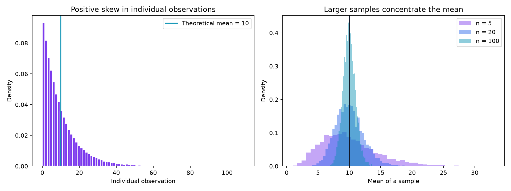

# How sample size changes uncertainty in a mean

Research question: How does increasing sample size change the variability of a sample mean when individual observations are strongly right-skewed?

## Data source and usage
The complete data are synthetic, generated by `analysis.py` with NumPy's random-number generator (seed 7204). The assumed distribution is exponential with scale 10. No person, survey respondent, institution or financial instrument is represented. No external dataset or restricted source is included. The synthetic data were generated for this analysis; copyright in project code and documentation is retained. A general reuse license has not been assigned.

## Method
Generate 100,000 illustrative individual observations and 5,000 independent sample means for each sample size 5, 20 and 100. Compare empirical standard deviations of these means with the theoretical standard error, 10 / sqrt(n). The 100,000 observations are used to display the population shape; the repeated samples are independent fresh draws from the same specified distribution.

Tools: Python 3.12, NumPy, pandas and Matplotlib. All current runs use the existing course project uv environment.

## Findings
For n=5, the empirical standard error is 4.507; for n=100 it is 1.001. The corresponding theoretical values are 4.472 and 1.000. Sample means concentrate around 10 and become more symmetric as sample size increases.




## Limitation
This is a simulation under a specified distribution with independent observations and finite variance. It does not demonstrate that real survey, financial or time-series observations are independent or exponentially distributed. Sampling uncertainty is distinct from bias. The empirical and theoretical values need not coincide exactly because the simulation has finite repetitions.

## Reproduce
Install Python 3.12 and uv. From this repository:

```sh
uv venv --python 3.12
uv pip install -r requirements.txt
uv run --no-project --python .venv/bin/python analysis.py
```

If using an existing uv project, install these recorded dependencies in that project's pyproject.toml/uv.lock and run the script using its Python interpreter. The script recreates the CSV data, summary, JSON results and both figures. `requirements.txt` records the versions used for verification.

## Organization
- `analysis.py`: direct reproducible analysis
- `data/`: generated individual observations, repeated sample means and numerical summary
- `figures/`: two readable visualizations
- `results.json`: machine-readable results

## Status
Analysis, synthetic data and both visualizations are publicly published and checked. The figures render in this repository. Genuine classmate feedback and a revision based on that feedback remain pending; no peer review is claimed.

[View the portfolio](https://oscarcarranzafeynman.github.io/data-science-portfolio/)

## AI declaration
ChatGPT helped prepare and check the code, figures and written explanation.
